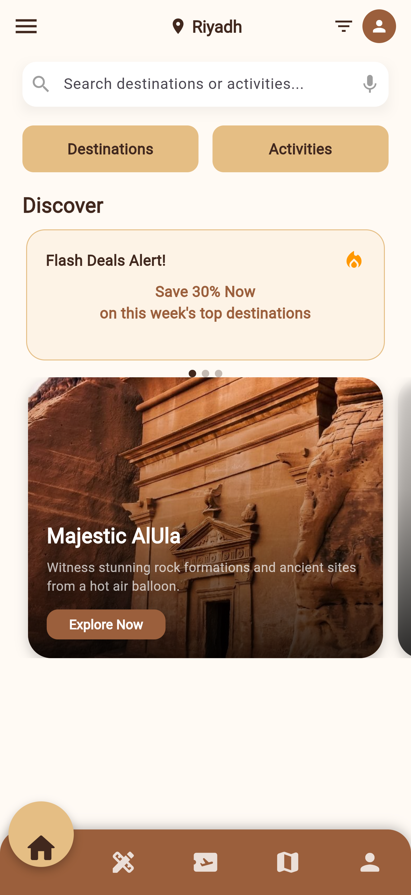
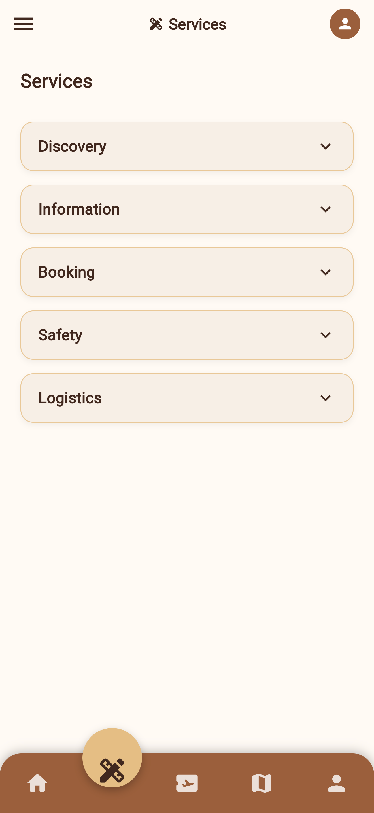
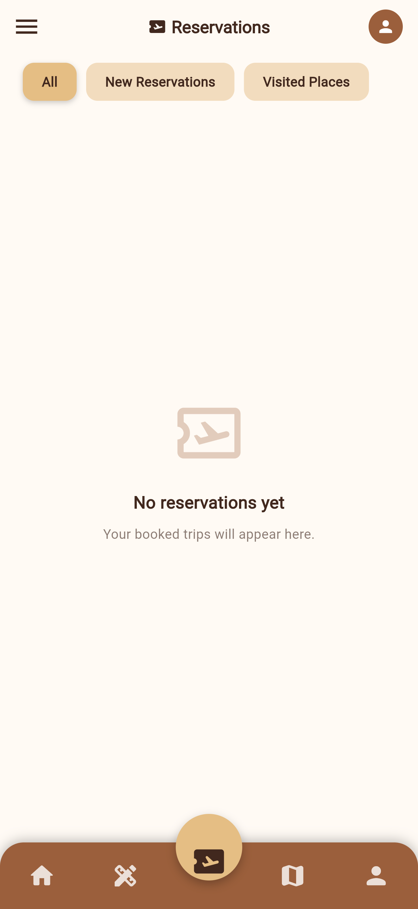

# 🏕️ TrekHorizon

A Flutter-based tourism and outdoor adventure application
designed to help users explore Saudi Arabia's natural
landscapes, cultural heritage, and recreational activities.

## Overview

TrekHorizon was developed as a university graduation project
to promote local tourism and simplify outdoor adventure
planning, supporting Saudi Vision 2030.

## Key Features

- User registration and login
- Tourist destination exploration
- Outdoor activity discovery
- Destination details and safety guidelines
- Interactive illustrative map
- Trip planning and date selection
- Dynamic booking cost calculation
- Simulated payment flow
- Reservation tracking
- Digital wallet interface
- User profile and settings
## Application Screenshots

### Onboarding Experience

<p align="center">
  
  
  
</p>

### Authentication

<p align="center">
  
  
  
</p>

### Explore & Plan

<p align="center">
  
  
  
</p>

### Reservations & Profile

<p align="center">
  
  
</p>


## Technologies Used

- Flutter
- Dart
- Material Design
- Cryptography
- Git & GitHub

## Getting Started

### Prerequisites

- Flutter SDK
- Dart SDK
- VS Code or Android Studio

### Run the Application

```bash
flutter pub get
flutter run -d chrome
```

## Project Structure

```text
lib/
├── db/
├── Screens/
├── widgets/
└── main.dart

assets/
└── images/

screenshots/
```

## Current Limitations

This project is a functional academic prototype.

- Payments are simulated.
- Reservations are stored temporarily during the session.
- The map uses illustrative locations rather than live GPS.
- Wallet and selected services are demonstration interfaces.
- Production-grade security is outside the current scope.

## Future Enhancements

- AI-powered travel recommendations
- Real-time GPS and map integration
- Persistent reservation storage
- Secure payment gateway integration
- Live tourism service integration

## Project Purpose

To demonstrate application development, UI/UX design,
data handling, and the implementation of an interactive
tourism booking workflow.

---

Developed with Flutter for a better outdoor adventure
experience in Saudi Arabia.